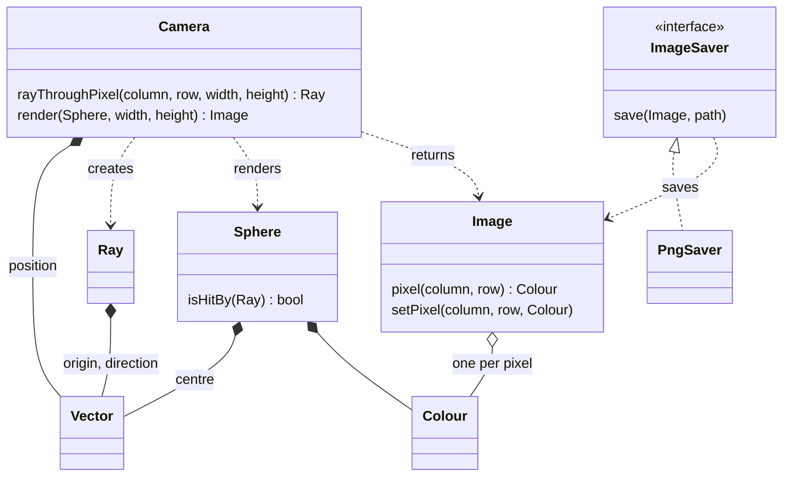

# Domain model

The concepts of the client's domain and how the code represents them. The words below are the ones we use in the code, the tests and the conversations with the client.

## Vocabulary

| Term | Meaning | In the code |
|---|---|---|
| Vector | A point or a direction in 3D space | `Vector` (`math/`) |
| Colour | A red, green and blue value between 0 and 1 | `Colour` (`colour/`) |
| Ray | A half-line with an origin and a direction | `Ray` (`geometry/`) |
| Sphere | A round object with a centre, a radius and a colour | `Sphere` (`geometry/`) |
| Camera | The eye and the screen it looks through | `Camera` (`render/`) |
| Image | A grid of coloured pixels | `Image` (`image/`) |
| Trace | Find the colour seen along one ray | `trace` (`render/`) |
| Render | Trace one ray per pixel to fill an image | `Camera::render` |
| Saver | Writes an image to a file | `ImageSaver`, `PngSaver` (`image/`, `io/`) |

## Relationships

`trace(Ray, Sphere)` is a function in `render/` that returns the colour of the sphere when the ray hits it and black otherwise.

## Conventions

See ADR 0006 for the world axes and the pixel grid.